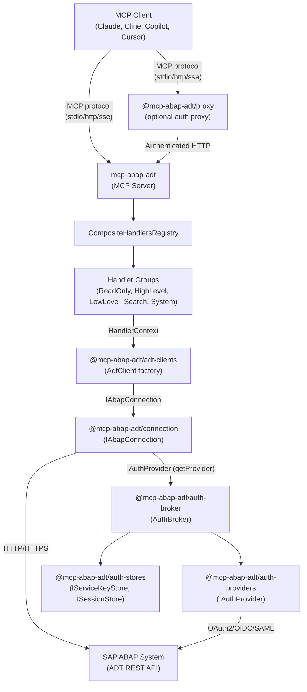

# MCP ABAP ADT -- System Architecture

This document provides a comprehensive architectural description of the **mcp-abap-adt** system: a multi-component, interface-driven TypeScript platform that enables AI assistants to interact with SAP ABAP systems through the ADT (ABAP Development Tools) REST API via the Model Context Protocol (MCP).

---

## 1. Architectural Principles

### 1.1 Interface-Only Communication (IOC)

All inter-package communication occurs exclusively through TypeScript interfaces, and each interface is imported from the package that declares it. No package imports concrete implementations from another package. This is not a guideline -- it is an enforced architectural invariant.

The contract used to be one package, `@mcp-abap-adt/interfaces`. It was split into `interfaces-adt`, `interfaces-auth`, `interfaces-auth-sap`, `interfaces-network` and `interfaces-utils`, and the umbrella that re-exported them is deleted -- npm serves its last release, 51.0.0, and nothing further ships there. An umbrella decides for every consumer which version of each contract they compile against, which is the coupling the split ends.

```typescript
// Correct -- depends on interface only, from the package that declares it
import type { ISessionStore } from '@mcp-abap-adt/interfaces-auth-sap';

// Prohibited -- creates concrete coupling
import { AbapSessionStore } from '@mcp-abap-adt/auth-stores';
```

### 1.2 Dependency Inversion

All high-level modules depend on abstractions (interfaces), not on low-level implementations. Concrete implementations are injected at the composition root (`launcher.ts` in the main server). This ensures that every component can be tested in isolation and replaced without modifying consumers.

### 1.3 Replaceable Default Implementations

Every interface shipped with the system has at least one default implementation. Consumers are free to substitute any default with a custom implementation that satisfies the same interface contract. The system makes no assumptions beyond what interfaces specify.

### 1.4 Separation of Concerns

Each package owns exactly one responsibility:

| Concern | Package |
|:---|:---|
| Interface contracts | `@mcp-abap-adt/interfaces-adt`, `-auth`, `-auth-sap`, `-network`, `-utils` |
| Logging abstraction | `@mcp-abap-adt/logger` |
| Credential storage | `@mcp-abap-adt/auth-stores` |
| Credential orchestration | `@mcp-abap-adt/auth-broker` |
| Credentials and token flows | `@mcp-abap-adt/auth-providers` |
| HTTP transport to SAP | `@mcp-abap-adt/connection` |
| ABAP object operations | `@mcp-abap-adt/adt-clients` |
| MCP protocol adapter | `mcp-abap-adt` (main server) |
| Authorization proxy | `@mcp-abap-adt/proxy` |
| Client configurator | `@mcp-abap-adt/configurator` |

### 1.5 Clear Runtime Contracts

Every public function and method operates against well-defined input/output types. Error conditions are expressed through typed error codes (`AdtObjectErrorCodes`, `TokenProviderErrorCodes`, `StoreErrorCodes`), not raw strings. This makes error handling deterministic across all consumers.

---

## 2. Component Catalogue

### 2.1 The contract packages

| Attribute | Value |
|:---|:---|
| **Responsibility** | Source of truth for all TypeScript interfaces, types, enums and error codes, one package per domain: `interfaces-adt` (ADT objects and the connection contract), `interfaces-auth` (tokens and providers), `interfaces-auth-sap` (SAP configuration, service keys, session stores), `interfaces-network` (HTTP frame and header names), `interfaces-utils` (logging, XML shapes) |
| **Dependencies** | `interfaces-adt` on `-network`; `-auth-sap` on `-auth`; the rest have none |
| **Replaceable** | N/A -- defines contracts, not implementations |
| **Runtime role** | Type-only at runtime (compile-time contracts) |

**Interface domains:**

| Domain | Key Interfaces | Purpose |
|:---|:---|:---|
| Connection | `IAbapConnection`, `IAbapRequestOptions`, `IAdtResponse` | HTTP communication with SAP ADT |
| Authentication | `IAuthorizationConfig`, `IConnectionConfig`, `IConfig` | Auth credential structures |
| Credential | `IAuthProvider`, `AuthOutcome` | What a connector presents: `prepare`, `establish`, `authorize`, `rejected` |
| Session | `ISessionStore`, `ISessionStorage`, `ISessionState` | Session persistence |
| Service Key | `IServiceKeyStore` | Service key access |
| ADT Objects | `IAdtObject<TConfig, TState>`, `IAdtObjectState`, `IAdtObjectConfig` | CRUD lifecycle for ABAP objects |
| Logging | `ILogger`, `LogLevel` | Structured logging |
| Validation | `IHeaderValidationResult`, `IValidatedAuthConfig` | Header analysis |
| SAP Config | `ISapConfig`, `SapAuthType` | SAP system configuration |
| Headers | `HEADER_*` constants, header group arrays | HTTP header contracts |

**Generic object model** -- every ABAP object type is modeled through two generic parameters:

- **`TConfig`** -- static metadata (name, package, description, transport request)
- **`TState extends IAdtObjectState`** -- accumulated operation results (read, create, lock, activate, errors)

This allows `IAdtObject<TConfig, TState>` to provide a uniform CRUD interface across all 22+ supported ABAP object types.

---

### 2.2 @mcp-abap-adt/logger

| Attribute | Value |
|:---|:---|
| **Responsibility** | Logging abstraction with two default implementations |
| **Public interface** | `ILogger` (info, error, warn, debug) |
| **Default implementations** | `DefaultLogger` (console-based), `PinoLogger` (structured, with fallback) |
| **Replaceable** | Yes -- any `ILogger` implementation accepted |
| **Runtime role** | Injected into all components that produce diagnostic output |
| **Dependencies** | `@mcp-abap-adt/interfaces-utils`; `pino` and `pino-pretty` as peer dependencies |

`PinoLogger` dynamically loads `pino` at runtime. If pino is not installed, it silently falls back to `DefaultLogger`. Both implementations respect the `AUTH_LOG_LEVEL` environment variable and redact sensitive fields (passwords, tokens, authorization headers).

---

### 2.3 Request credentials (HTTP/SSE headers)

| Attribute | Value |
|:---|:---|
| **Responsibility** | Turns the connection headers of a request into a `ConnectionSource`: settings and a credential |
| **Where** | `src/lib/credentialSources.ts` (`credentialFromHeaders`), `src/lib/httpTransport/headerSource.ts` (`headerSource`, `headerContext`, the two `400` sentences) — `@mcp-abap-adt/lib/http-transport` |
| **Runtime role** | The only credential `@mcp-abap-adt/http` (per request) and `@mcp-abap-adt/sse` (per SSE connection, from its opening `GET`) take; stdio has no request headers |

| Method | Headers |
|:---|:---|
| A token you hold | `x-sap-url` + `x-sap-jwt-token` |
| Basic | `x-sap-url` + `x-sap-login` + `x-sap-password` |

A request without them is answered `400` (`ping` excepted); a request carrying `x-mcp-destination`
is answered `400` too — destinations are core's, over stdio. A header connection gets a fixed
credential (`TokenAuthProvider.fixed`, `BasicAuthProvider`); nothing renews it, and nothing is
stored, shared or cached across requests.

---

### 2.4 @mcp-abap-adt/auth-stores

| Attribute | Value |
|:---|:---|
| **Responsibility** | Persistent storage for service keys and session data |
| **Public interfaces** | `IServiceKeyStore`, `ISessionStore` |
| **Default implementations** | `AbapServiceKeyStore`, `XsuaaServiceKeyStore`, `AbapSessionStore`, `XsuaaSessionStore` |
| **Replaceable** | Yes -- consumers can provide any `IServiceKeyStore` / `ISessionStore` |
| **Runtime role** | Supplies credentials and persists tokens between sessions |
| **Dependencies** | `@mcp-abap-adt/interfaces-auth-sap`, `dotenv` |

Service key stores read `{destination}.json` files from a configurable directory. Session stores persist authorization and connection configurations per destination. ABAP and XSUAA variants differ in JSON structure parsing, not in interface contract.

---

### 2.5 @mcp-abap-adt/auth-broker

| Attribute | Value |
|:---|:---|
| **Responsibility** | Builds the credential a destination states, from the service key store's *means* and the session store's *secret*, and keeps what the credential obtains stored |
| **Public interface** | `AuthBroker` (`getProvider(destination)`, `flush()`, `getConnectionConfig`, `getAuthorizationConfig`), `DestinationConfigError` |
| **Runtime role** | One broker per destination; `getProvider` returns an `IAuthProvider` that a connector presents on every logon and request |
| **Dependencies** | `interfaces-auth`, `interfaces-auth-broker`, `interfaces-auth-sap`, `auth-providers` |

The server calls `getProvider(destination)` and hands the provider to the connector; there is no token to fetch first and no token refresher. The provider decides whether its token is still good, renews it (refresh first, then a new login) and the broker writes what it obtained to the session store. `flush()` tells the server at shutdown whether everything landed.

`AuthBroker` takes a service key store (means), a session store (the secret alone) and, for the interactive grant, an `authorization` strategy that the server supplies (the browser login on port `61001`). The stores and the strategy are injected, never defaulted by the broker.

---

### 2.6 @mcp-abap-adt/auth-providers

| Attribute | Value |
|:---|:---|
| **Responsibility** | Every `IAuthProvider`: the credential a process presents, and the token providers behind it |
| **Public interface** | `IAuthProvider` (`prepare`, `establish`, `authorize`, `rejected`) from `interfaces-auth` |
| **Replaceable** | Yes -- any `IAuthProvider` |
| **Runtime role** | Built by the broker for a destination; the connector calls its four methods |
| **Dependencies** | `@mcp-abap-adt/interfaces-auth`, `-auth-sap`, `-utils`, `axios`, `express`, `open` |

core (stdio) supports three authentications, each served by one handler (`server-runtime/src/stdio/auth/handlers/`); `jwt` / `none` is refused — a token you hold is http's and sse's `x-sap-jwt-token` header (`TokenAuthProvider.fixed`):

| Authentication | `SAP_AUTH_TYPE` / `SAP_GRANT_TYPE` | Provider |
|:---|:---|:---|
| Basic (HTTP or RFC) | `basic` | `BasicAuthProvider` |
| SNC (RFC only, passwordless) | `snc` | `SncLogonProvider` |
| JWT, browser login | `jwt` / `authorization_code` | `AuthorizationCodeProvider` |

Adding an authentication means a handler there, a row in this table and a test; nothing else. The package ships other providers (client credentials, passcode, the OIDC and SAML ones); this server does not serve them, and a destination that states one is refused at startup.

---

### 2.7 @mcp-abap-adt/connection

| Attribute | Value |
|:---|:---|
| **Responsibility** | HTTP transport layer to SAP ADT REST API |
| **Public interface** | `IAbapConnection` |
| **Default implementations** | `AdtOnPremConnector`, `AdtCloudConnector` -- one connector per *system*; the credential is a parameter, not a subclass |
| **Replaceable** | Yes -- any `IAbapConnection` implementation |
| **Runtime role** | Executes ADT requests over HTTP or RFC against a SAP system, presenting the `IAuthProvider` it is handed |
| **Dependencies** | `@mcp-abap-adt/interfaces-auth`, `-auth-sap`, `-utils`, `axios` |

**Construction** -- the server has one place that builds a connector (`src/lib/connectionFactory.ts`): the system kind and the wire follow from the settings (`SAP_SYSTEM_TYPE` — required, never guessed: none, or a value other than `onprem` / `cloud` / `legacy`, is `system_type_required` before anything is sent —, `connectionType`), and the credential is the one the caller hands in. Where a credential comes from is `src/lib/credentialSources.ts` (headers, an embedder's `SapConfig`) or the broker's `getProvider(destination)`; the factory never builds one from `settings.authType`.

**Key capabilities:**
- CSRF token management (automatic fetch, cache, refresh on error)
- Stateful or stateless per request: while the connection's session type is stateful (adt-clients sets it around one `LOCK` or one `UNLOCK`), a request goes with `x-sap-adt-sessiontype: stateful` and the `sap-contextid` context cookie over HTTP, or in the stateful conversation over RFC; every other request goes stateless, without the context cookie
- Cookie management for session persistence
- A `401` the wire's own recovery cannot clear is put to the credential (`rejected`); if it answers Ok (a renewed token), the request gets one more attempt
- The HTTPS server certificate verified by default (connection 11); `TLS_REJECT_UNAUTHORIZED=0` or `NODE_TLS_REJECT_UNAUTHORIZED=0` in the process environment opts out, `NODE_EXTRA_CA_CERTS` adds a CA
- Retry logic for transient errors

---

### 2.8 @mcp-abap-adt/adt-clients

| Attribute | Value |
|:---|:---|
| **Responsibility** | Domain logic for ABAP object CRUD operations |
| **Public interface** | `IAdtObject<TConfig, TState>` per object type |
| **Default implementation** | `AdtClient` (factory), 22+ object-type handlers |
| **Replaceable** | Yes -- via interface |
| **Runtime role** | Called by MCP tool handlers to perform SAP operations |
| **Dependencies** | `@mcp-abap-adt/interfaces-adt`, `-auth`, `-network`, `-utils`, `@mcp-abap-adt/logger`, `fast-xml-parser` |

**AdtClient** is a factory that creates typed object handlers:

```typescript
const client = new AdtClient(connection, logger);
const program = client.getProgram();     // → IAdtObject<IProgramConfig, IProgramState>
const cls = client.getClass();           // → IAdtObject<IClassConfig, IClassState>
const func = client.getFunctionModule(); // → IAdtObject<IFunctionModuleConfig, IFunctionModuleState>
```

**Supported ABAP object types** (22+): Class, Program, Interface, Domain, DataElement, Structure, Table, TableType, View, FunctionGroup, FunctionModule, Package, ServiceDefinition, BehaviorDefinition, BehaviorImplementation, MetadataExtension, Enhancement, UnitTest, CdsUnitTest, Transport Request, LocalDefinitions, LocalTypes, LocalMacros, LocalTestClass.

**Operation chains** -- create and update operations are multi-step sequences:

```
Create: validate → create → check → lock → update → unlock → check → activate (optional)
Update: lock → check → update → unlock → check → activate (optional)
Delete: check(deletion) → delete
Read:   single GET request
```

Each step accumulates results in `TState`, providing full audit trail of the operation.

**AdtUtils** provides cross-cutting utilities: repository search, where-used analysis, package hierarchy traversal, table content queries, inactive object lists, and batch operations.

---

### 2.9 mcp-abap-adt (Main MCP Server)

| Attribute | Value |
|:---|:---|
| **Responsibility** | MCP protocol adapter -- translates MCP tool calls into ADT client operations |
| **Runtime role** | Primary application entry point; one composition root per binary |
| **Packages** | `@mcp-abap-adt/server-runtime` (`server-runtime/`, no command): the launch code of the three transports; `@mcp-abap-adt/core` (`server/`, `mcp-abap-adt`: stdio), `@mcp-abap-adt/http` (`http/`, `mcp-abap-adt-http`: Streamable HTTP), `@mcp-abap-adt/sse` (`sse/`, `mcp-abap-adt-sse`: HTTP+SSE), each its bin and version over the runtime, on `@mcp-abap-adt/lib`, `@mcp-abap-adt/background-runs-memory` and `@mcp-abap-adt/responsible-rules`; the compact and `-ro` packages are one call each of the runtime's `main` of their transport with another tool set (Composition Roots below) — twelve binaries in all, none depending on another |
| **Dependencies** | All packages above + `@modelcontextprotocol/sdk`, `zod`; `@mcp-abap-adt/auth-broker` and `@mcp-abap-adt/auth-stores` are `server-runtime`'s dependencies, so every server installs them, and only its stdio paths (`/stdio`, `/stdio/server`, `/auth`) load them |

#### The three packages and their connection sources

`BaseMcpServer` (lib) holds one **connection source** per instance — the contract each package
fills (`src/embeddable/ConnectionContext.ts`):

```ts
interface ConnectionSource {
  resolve(signal: AbortSignal): Promise<{ settings: SapConfig; credential: IAuthProvider; systemContext? }>;
}
type Source =
  | { kind: 'built'; source: ConnectionSource }        // core: a destination; http, sse: the headers
  | { kind: 'injected'; connection: AbapConnection };  // embedded: the consumer's, used as given
```

| Package | Source | Connection |
|:---|:---|:---|
| core (stdio) | `destinationSource(destination, factory)`: `settingsFor`, `getProvider(destination, { signal })`, `systemContextFor` | kept for the instance's life: `getProvider` answers the same provider for the process (the user is fixed; the session is renewed and written back by that provider); replaced only when SAP already lost the session, built with that same provider |
| http | `headerSource(req.headers)` per request, on a new instance or the pooled one its `state_handle` names | one per request |
| sse | `headerSource` of the `GET` that opened the connection | one per SSE connection |
| embedder | `{ kind: 'injected', connection }` (`EmbeddableMcpServer`) | the consumer's, never connected or wrapped |

The dependency rule is a test (`src/__tests__/unit/packages/dependencyRule.test.ts`): the published
lib and the http and sse packages declare and reach no broker, stores or `interfaces-auth-broker`;
`server-runtime` declares them and only its stdio paths reach them; http and sse never reach each
other; no binary package depends on another (`packageSet.test.ts`), and `lib` is a peer of every
package below the binaries — see [One `lib` per server process](README.md#one-lib-per-server-process-1920).

#### The stateful window and the main flow

**Only `LOCK` and `UNLOCK` are sent stateful; writes under a lock and activation go
stateless.** Both requests are marked by adt-clients (since 31.1), not by the server: the
`LOCK` alone and the `UNLOCK` alone, each inside `inStatefulSession` or a
`try`/`finally` that sets the connection back to stateless whatever the request
answered. The write under the lock goes outside the lock's context, as Eclipse sends
it (the lock handle carries it). The server itself turns no tool's session stateful:
its one stateful site is the debugger's own session (`src/lib/debugger/ports.ts`),
and the listed long tools and background runs set their own fresh connections
stateless. Batch mode only forwards: a recorded call's `LOCK` / `UNLOCK` asks the
batch connection (adt-clients' `AdtBatchConnection`, through the per-call recorder,
`src/lib/batch/recorder.ts`) to mark that request stateful, and at `BatchEnd`
`execute()` sends the LOCK / UNLOCK runs as stateful envelopes on the instance's
connection in force, reached through the late-bound target
(`src/lib/batch/lateBound.ts`), restoring its session type afterwards. Every site is
a row of `tools/stateful-sites.json` with the window it
opens and where it returns to stateless — the recorder's and the late-bound
target's forwards included; `src/__tests__/unit/sources/statefulSites.test.ts`
holds the scan of the server's sources and adt-clients' installed `dist` equal to it.

**One MCP session = one connector = one main flow.** The session type is the
connection's (since connection 17.1): adt-clients switches it with `setSessionType` around
the request, and the connection reads it when the request is built, after an
`await`. Two calls at once on one connection would cross — a read sent while another
call's `LOCK` is in flight goes stateful, an `UNLOCK` whose credential is still
being asked goes stateless once another call's window closed (both seen against the
stand-in). So the server does not trust the client: the calls of an instance that
work on its connection run strictly one after another (`BaseMcpServer.enterMainFlow`,
in the registered tool wrapper). The next waits until the previous settled, with no
timeout. **A tool call cannot be cancelled**: it ends with its result or with the
session — a client's cancel aborts nothing, a queued call keeps its place. When the
client closes its connection (stdio's stdin, an SSE stream) and at the process
shutdown, the running calls are interrupted, the queued ones never start, and every
connection the instance owns is logged off at once (`closeInstance`, `logOffAtOnce`):
nothing waits for a running tool or a request in flight — the logoff releases the locks,
and a tool's later requests fail against the ended session. Over Streamable HTTP a
dropped request closes nothing and ends no call: an admitted call — waiting for its
connection, its system lookup or its turn, or running — runs to its end, and the pool ends its
instance as before. An embedder's own registry that is not a `CompositeHandlersRegistry` gets no
main-flow queue.
Every send on the instance's connection is inside the order: the identity lookups
(`systeminformation`, asked on every kind of system through the shipped resolver — its user
wins over any configured login; no information on-premise: the responsible if stated, else the configured login, with neither
`system_user_unknown`; on ABAP Cloud a `404` `cloud_without_systeminformation`, anything else
`system_lookup_failed`; a `401` the credential failure as it came)
of the background-run tools and the debugger's request user go through `onMainConnection` — directly from a call that
already holds the flow (an `AsyncLocalStorage` mark), on the connection that call holds,
else in turn, on the connection taken inside the flow (so a session the call ahead lost
is already replaced); the send is handed its connection and captures none. A caller
already known — the user SAP named for the credential — is answered at once, without
entering the flow, so a background run never waits for a lookup it does not send; the
leftover-session tools send none at all (their caller is the destination the instance
serves). A cached user is valid only for the
connection it was asked on: whenever the instance's connection is replaced,
the whole cache is forgotten, every credential's entry, and asked again on the
replacement. Outside the order,
because they work on a connection of their own: a background run, a listed long read
(its fresh connection) and the debugger tools, whose SAP work is on the debugger's own connections (every `Debug*`, `AmdpDebug*` and `HandlerDebug*` tool; the `MemorySnapshot*` tools read the instance's connection and stay in the flow) (`src/lib/debugger/ownConnectionTools.ts`). The flow
is entered after the connection is ready, so concurrent callers still share one
`connect()`; once in the flow, a queued call checks its connection again (`isStaleBuilt`): when the call ahead found the session lost, it gives the spent connection back and takes the replacement before its tool runs, so only the call that met the loss fails (it is not replayed). Over Streamable HTTP the held connection takes each request's credential (`CurrentCredential`: a renewed token, a new basic pair — the same user) in the same SAP session; only a session SAP ended replaces it. On stdio the instance's connection is born at the process's start, before the transport opens (`StdioServer.connectAtStart` → `bornAtStart` → `buildConnection`): the destination's one leftover session taken up (`resumedSession`; with none or several, a logon), so no call is in the flow then; there is no resume tool. The list and the logoff take no turn: neither touches the instance's connection. The connections that are shared this way are stdio's kept one and an
SSE connection's; Streamable HTTP builds one per request. A connection's **parameters** — the
responsible and master system a create fills, which also name the debugger's request user and a
background run's caller — are made once, together with the connection, per destination (the
resolved credential and its target system — URL, client, wire —, not the session): on stdio at the
start (`bornAtStart`, or the leftover session's file), a failure ending the process before the
transport opens; on SSE once per stream, on Streamable HTTP when the pooled instance's connection is
created (`buildConnection` → `requireSystem`), a failure that call's answer — the connection ends
and nothing is kept, so the next call that creates one asks again. Never after a tool: **no tool
runs twice**. The lookup (`systeminformation`, through the resolver the host passes; none by
default) answers only the information, no information, or a credential failure (a chain failure, a
`401`: the call's as it came); what the parameters are is the rules' the host passes
(`SystemContextRules`): every server (server-runtime's launchers) passes `@mcp-abap-adt/responsible-rules` — the information
wins; no information is, on ABAP Cloud, one step to the error (a `404`
`cloud_without_systeminformation`: the configuration or headers are inconsistent; anything else
`system_lookup_failed`), on-premise the stated responsible (`x-sap-responsible`, `SAP_RESPONSIBLE`,
the destination's), else the login (the destination's `SAP_USERNAME`, else its `x-sap-login`),
else `system_user_unknown`; no kind `system_type_required`. lib applies none: an embedder gets a
lookup only with a resolver, and the rules only when it passes them. A new session of the same
destination — a replacement after a lost session, a new logon after a gone leftover (the file's) —
keeps its parameters (`destinationSystems`), known per credential object and target system. The tool wrapper applies them (`withKnownSystemContext`) and sends nothing; a host's
injected connection has them made by its first call (`systemBeforeTool`), inside the main flow.

- **Compact's `HandlerLock`** keeps the lock across calls until `HandlerUnlock` —
  the consumer's choice — where the connection lives across calls (stdio, SSE): the
  lock's ABAP context stays in the session (its `sap-contextid` cookie is kept), the
  calls between run stateless and outside it, and the `UNLOCK` reaches it. At the
  latest the instance's logoff ends it: a logoff releases the session's locks. Over
  Streamable HTTP the lock is the pooled instance's state: a request on its
  `state_handle` — the `state_handle` argument, or the `x-mcp-state-handle` header — reaches
  the held connection — with that request's credential, in the same SAP session — until the
  `UNLOCK`, until the instance's logoff (a long session's close — `SessionClose`, compact
  `HandlerSession` `action: 'close'` —, the idle bound) or until SAP ends the session.
- **A tool call cannot be cancelled.** A client's cancel aborts nothing: the call
  runs to its end; nothing is logged off and no session is reopened. The client's
  close (stdio, SSE) and the process shutdown are what end a running tool: its
  sessions logged off at once.
- **A reopen only when SAP already lost the session.** stdio keeps its connection
  for the instance's life; http builds one per request (a pooled instance too, from
  that request's headers), sse one per SSE connection.
- **On stdio the caller is the kept session's user.** The user is fixed for the
  process: the session is renewed (refresh token, or a new login when the refresh
  fails) and written back — the same user — so the caller of the background-run tools
  is always the user of the session the instance keeps — every tool runs in SAP as that
  user — and the caller of the leftover-session tools is the destination the process
  serves. HTTP and SSE never keep a connection across
  credentials, and keep no runtime session file: the leftover-session tools are stdio's
  (one http or sse server holds the sessions of many users).

#### Composition Roots

`server-runtime/src/stdio/launcher.ts` (core), `server-runtime/src/http/launcher.ts` and `server-runtime/src/sse/launcher.ts` wire each
binary. Each `main({ toolSet, program, version, packageName })` takes the tools as a `ToolSet`
(`@mcp-abap-adt/lib/tool-set`) and nothing else of them, and the binary fixes it: the full
bins pass `fullToolSet`, the read-only packages (`core-ro/`, `http-ro/`, `sse-ro/`)
`fullReadOnlyToolSet`, the compact packages (`compact/`, `compact-http/`, `compact-sse/`)
`compactToolSetOf` with the two halves' entry builders, and the read-only compact ones
(`compact-ro/`, `compact-http-ro/`, `compact-sse-ro/`) `compactReadOnlyToolSetOf` with the read-only
half — so the four sets share every transport's behaviour:

```
main({ toolSet, program, version, packageName })
  ├── libInstances()                                 // more than one copy of lib: the guard line, exit 1
  ├── readStartupConfig(<binary>Parameters(toolSet))  // its own table; the set's removed --exposition
  │                                                   //   stops the start, naming the binary to use
  ├── registryOf(toolSet)                             // full: ReadOnly, System, BackgroundRun, HighLevel,
  │                                                   //   Debug, Search, LeftoverSession; ro: ReadOnly,
  │                                                   //   System, Search, the list and logoff; compact:
  │                                                   //   both halves, debug tools, background runs, ...
  ├── a background-run store only if toolSet.backgroundRuns
  ├── core only: AuthBrokerFactory                    // the destination, the startup check
  └── StdioServer | StreamableHttpServer | SseServer
```

#### Handler Architecture

Handlers are organized into groups by access level:

| Group | Purpose | Approx. Tool Count |
|:---|:---|:---|
| `ReadOnlyHandlersGroup` | Get operations (read source, metadata) | ~29 |
| `HighLevelHandlersGroup` | Full CRUD (Create, Update, Delete, Get) | ~121 |
| `SearchHandlersGroup` | Repository search, where-used | ~4 |
| `SystemHandlersGroup` | System info, discovery | ~30 |
| `BatchHandlersGroup` | Batch mode: `BatchBegin`, `BatchEnd`, `BatchAnswers` (every full set, `-ro` included; the compact sets serve `HandlerBatch`) | 3 |

Counts drift as tools are added; see [AVAILABLE_TOOLS.md](../user-guide/AVAILABLE_TOOLS.md) for the authoritative, up-to-date list.

The binary installed decides which groups are active: a `-ro` binary for read-only
deployments, a write binary for full access.

**Handler registration flow:**

```
CompositeHandlersRegistry
  └── for each IHandlerGroup:
        └── BaseHandlerGroup.registerHandlers(server)
              └── for each HandlerEntry:
                    ├── Convert JSON Schema → Zod
                    ├── Wrap handler with context injection
                    └── server.registerTool(name, schema, wrappedHandler)
```

Each handler follows a uniform pattern:

```typescript
// Tool definition (static metadata)
export const TOOL_DEFINITION = {
  name: "GetProgram",
  description: "Retrieve ABAP program source code",
  inputSchema: { type: "object", properties: { program_name: { type: "string" } }, required: ["program_name"] }
} as const;

// Handler function (receives injected context)
export async function handleGetProgram(context: HandlerContext, args: GetProgramArgs) {
  const client = new AdtClient(context.connection, context.logger);
  const result = await client.getProgram().read({ programName: args.program_name }, args.version || 'active');
  return return_response(result);
}
```

`HandlerContext` contains the `IAbapConnection` and optional `ILogger` -- injected per-request by `BaseMcpServer` -- and,
where the host gave one, the instance's batch owner (`batch`, an `InstanceBatch`), which the batch tools reach.

**Batch mode.** While a batch is open, `BaseMcpServer`'s dispatch records each call the eligibility table
(`tools/batch-handlers.json`) admits — its handler runs on a per-call recorder over adt-clients'
`AdtBatchConnection`, numbered in the order made — and refuses every other call. `BatchEnd` takes the
instance's connection in its turn, holds it for the whole `execute()`, and every recorded handler then
builds its answer from what SAP answered; batch mode ends whatever fails. Where the instance has a
batch owner, every tool's description, as registered, ends with one sentence (`src/lib/batch/sentence.ts`)
saying how a call of it behaves in batch mode: "Recordable: …", "When <arguments>, recordable: …"
(the arguments in words, from the table's `when` and `connection`) or "Runs outside batch mode.". See [Batch Mode](../user-guide/BATCH_MODE.md).

#### Transport Servers

| Transport | Package | Class | Connection Model | Session Management |
|:---|:---|:---|:---|:---|
| stdio | core | `StdioServer` | Kept while the destination's provider is the same | Single persistent session |
| HTTP | http | `StreamableHttpServer` | Per request, from its headers | Stateless; held state in pooled instances by `state_handle` |
| SSE | sse | `SseServer` | Per connection, from its opening `GET` | Map by session ID |

All transports extend `BaseMcpServer` which handles handler registration, connection context management, and per-request context injection.

> **Design invariant:** One MCP session always maps to one SAP system, and switching SAP systems within the same session is not a supported scenario.
>
> Where the identity behind a call comes from is a separate question, and since 10.1.0 it has one answer. `masterLanguage`, `responsible` and `masterSystem` are read from the request scope when a scope carries them, and from the process-wide system context otherwise. A host that serves several SAP users side by side wraps each run in `runWithRequestContext`; a stdio session carries no scope and keeps the process context, unchanged. The singleton cache remains the fallback, not the source: a concurrent host that relied on it saw every create attributed to whichever user wrote it last.
>
> Since 10.2.0 there is a third source, and it is last. When a call still has no `responsible` or `masterSystem` and its connection is to ABAP Cloud, the library asks the system once per connection and fills only what is absent. A key the scope carries wins even when its value is `undefined`, because carrying it is how a host says this request has none. On-premise nothing is asked and nothing is filled. A host can pass its own resolver, or `null` to switch the whole thing off.

---

### 2.10 @mcp-abap-adt/proxy (Auxiliary Utility)

| Attribute | Value |
|:---|:---|
| **Responsibility** | Authorization proxy between MCP clients and remote MCP servers on BTP |
| **Architectural relationship** | Fully independent -- can proxy to ANY MCP server, not just mcp-abap-adt |
| **Runtime role** | Intercepts requests, obtains JWT via XSUAA, forwards authenticated requests |
| **Transport modes** | `stdio`, `streamable-http`, `sse` |
| **Dependencies** | `@mcp-abap-adt/auth-broker`, `@mcp-abap-adt/auth-providers`, `@mcp-abap-adt/auth-stores`, `@mcp-abap-adt/interfaces-adt`, `-auth`, `-auth-sap`, `-utils`, `@modelcontextprotocol/sdk`, `axios` |

The proxy is **not** part of the main server's runtime. It is a standalone utility for scenarios where MCP clients (Cline, Copilot, Cursor) cannot perform BTP authentication directly.

**Key capabilities:**
- JWT token management with 30-minute cache TTL
- Multi-destination support (per-destination auth brokers)
- Circuit breaker pattern for resilience
- Retry with exponential backoff
- Service key-based MCP server URL discovery
- Request/response logging with sensitive data redaction
- Eager authentication (browser opens on startup for stdio mode)

---

### 2.11 @mcp-abap-adt/configurator (Auxiliary Utility)

| Attribute | Value |
|:---|:---|
| **Responsibility** | Automates MCP server registration in client configuration files |
| **Architectural relationship** | Fully independent -- no runtime dependency on any other package |
| **Supported clients** | Cline, Claude, Codex, Cursor, Copilot, Goose, Windsurf, OpenCode, Antigravity, Qwen, Crush (11 total) |
| **Operations** | add, rm, ls, show, enable, disable, where, update, tui |

A pure CLI/TUI tool that handles platform-specific and client-specific configuration file formats (JSON, YAML, TOML) across global and project scopes.

---

## 3. Submodule Clarification

Each package is an **independent git repository** with its own version, build pipeline, test suite, and npm publication. For development convenience, packages can be aggregated using **git submodules**:

```
mcp-abap-adt/              ← Own git repo, published to npm
mcp-abap-adt-interfaces/   ← Own git repo, published to npm
mcp-abap-adt-clients/      ← Own git repo, published to npm
mcp-abap-connection/       ← Own git repo, published to npm
...                        ← Each package is independent
```

**Critical distinction:**

- **Submodules are purely administrative** -- they enable synchronized development and convenient cross-package navigation, but are not required
- **Architectural isolation remains intact** -- each package has its own `package.json`, version, build pipeline, test suite, and npm publication
- **Submodule grouping does not equal monolith** -- consuming packages individually from npm changes nothing architecturally
- **No package references another package's source code** -- all inter-package dependencies go through npm-published interfaces

---

## 4. Runtime Interaction Model

### 4.1 High-Level Component Interaction



### 4.2 Request Processing Flow (HTTP Transport)

```
1. HTTP POST /mcp/stream/http
   └── StreamableHttpServer.createRequestHandler()

2. Per-request server creation
   └── new BaseMcpServer() instance per request

3. Connection source
   ├── x-mcp-destination → 400 (destinations are core's, over stdio)
   ├── no x-sap-url with a token or a user and password → 400 (ping excepted)
   └── headerSource(req.headers) → the instance's source: settings and a fixed credential

4. Handler invocation
   ├── BaseMcpServer resolves tool name → handler function
   ├── Creates HandlerContext { connection: IAbapConnection, logger: ILogger }
   └── Calls handler(context, args)

5. ADT operation execution
   ├── Handler creates AdtClient(connection, logger)
   ├── Calls typed operation (e.g., client.getProgram().read(...))
   ├── AdtClient delegates to IAbapConnection.makeAdtRequest()
   └── Connection handles auth, CSRF, retries, session

6. Response
   └── Handler returns MCP-formatted response (text content)
```

### 4.3 Inversion of Control Boundaries

The system has three distinct IoC boundaries:

| Boundary | What is Inverted | Composition Point |
|:---|:---|:---|
| **Auth** | The credential a connector presents | the instance's `ConnectionSource` answers it (an `IAuthProvider`): `AuthBrokerFactory.getProvider` (core) or the headers (http, sse); the connector never builds one |
| **Transport** | HTTP communication with SAP | `AdtClient` constructor receives `IAbapConnection` |
| **Handlers** | Tool behavior per transport/mode | `CompositeHandlersRegistry` receives `IHandlerGroup[]` |

### 4.4 Composition Root Location

`server-runtime/src/stdio/launcher.ts` is core's composition root (stdio). It:

1. Refuses a second copy of `@mcp-abap-adt/lib` in the process (`libInstances()`; one line on stderr, exit `1`), before anything else
2. Reads configuration (CLI, YAML, env)
3. Chooses the stores of a destination (`server-runtime/src/stdio/auth/destinationStores.ts`): an env file, or a named destination's `sessions/<name>.env` over `service-keys/<name>.json`
4. Passes the browser-login strategy (`browserCallbackStrategy`) to `AuthBrokerFactory`; the library defaults to none
5. Assembles one `AuthBroker` for the destination via `AuthBrokerFactory`; the startup check builds the credential, and the connection is born at the start — the destination's one leftover session taken up, else a logon, and the system information asked — before the MCP transport opens; any failure exits `1`
6. Assembles the registry of the tool set it is given (`registryOf(toolSet)`)
7. Starts `StdioServer` with `destinationSource`

`server-runtime/src/http/launcher.ts` and `server-runtime/src/sse/launcher.ts` refuse a second copy of `lib` the same way, read their configuration, assemble the
registry of the tool set they are given and start their server; neither has a broker, a store
or a login. `compact/`, `compact-http/` and `compact-sse/` are each one call of the runtime's
`main` of their transport with the compact tool set; the six `-ro` packages one call each with a read-only set.

No other file in the system creates concrete cross-package dependencies.

---

## 5. Extensibility Model

### 5.1 Replacing Default Implementations

Any interface-backed component can be replaced. The general pattern:

```typescript
// 1. Implement the interface
class CustomSessionStore implements ISessionStore {
  // the contract is in @mcp-abap-adt/interfaces-auth-broker: a session store
  // holds the secret alone (token or cookies, expiry, refresh token, issuedFor, issuedBy)
}

// 2. Inject at the composition root (destinationStores.ts)
const broker = new AuthBroker({
  serviceKeyStore, // the means: authType, grantType, URL, client
  sessionStore: new CustomSessionStore(),
  authorization: () => browserLogin, // for authorization_code
});
```

### 5.2 Custom Authentication Logic

To add an authentication the server serves:

1. **Implement or reuse an `IAuthProvider`** (`prepare`, `establish`, `authorize`, `rejected`; none may throw -- each answers `{ ok: true }` or a refusal)
2. **Add an `AuthenticationHandler`** in `server-runtime/src/stdio/auth/handlers/` that tells the broker what the destination needs, and register it in `HANDLERS`
3. Add its row to the table in section 2.6 and a test; the rest of the system remains unchanged -- the connector presents whatever `IAuthProvider` it is given

An embedder that has its own connection passes it as an injected source (`EmbeddableMcpServer`'s `connection`); one that has its own credential gives a `ConnectionSource` whose `resolve` answers it, and the server builds nothing from settings.

---

### 5.3 Custom Configuration Handling

Each binary reads its own parameter table through lib's machinery (`src/lib/config/authParameters.ts`):
`CORE_PARAMETERS` (`server-runtime/src/stdio/config/coreParameters.ts`: the destination, browser and login rows),
`HTTP_PARAMETERS` (`server-runtime/src/http/config/httpParameters.ts`) and `SSE_PARAMETERS`
(`server-runtime/src/sse/config/sseParameters.ts`), each beside lib's shared rows (`--conf`,
`--system-type`, `--state-idle-minutes`; the TLS rows in http and sse), and the tool set's removed
`--exposition`. A table gives:
- CLI arguments, environment variables and YAML keys (`--conf <path>`; configuration only, a secret-looking key is refused); CLI beats env beats YAML
- the help text, the `--conf` template and the YAML validation
- the refusal of every other binary's options, and of `--transport` (gone), naming the binary that serves it

For deeper customization, consumers can build the config directly (`CoreConfig`, `HttpConfig`, `SseConfig`, each extending lib's `IServerConfig`), or a table of their own with `readParameters`.

### 5.4 Extending MCP Tool Behavior

To add new tools:

1. **Create a handler** following the existing pattern (TOOL_DEFINITION + handler function)
2. **Create a handler group** implementing `IHandlerGroup`
3. **Register it** via `CompositeHandlersRegistry.addHandlerGroup()`

```typescript
class CustomHandlerGroup extends BaseHandlerGroup {
  protected groupName = 'CustomHandlers';

  getHandlers(): HandlerEntry[] {
    return [
      {
        toolDefinition: { name: 'CustomTool', description: '...', inputSchema: { ... } },
        handler: (context, args) => handleCustomTool(context, args),
      },
    ];
  }
}

// At composition root
registry.addHandlerGroup(new CustomHandlerGroup(baseContext));
```

### 5.5 Architectural Guarantees

- **Interface stability** -- every contract package follows semver; breaking changes require major version bumps, and a consumer takes them one domain at a time rather than inheriting every package's history through an umbrella
- **No hidden state** -- components do not share global mutable state (the server holds no global broker registry: each `AuthBrokerFactory` owns its brokers, and the process serves its destinations through it)
- **Typed errors** -- all error conditions use typed error code constants, enabling programmatic error handling
- **Operation auditability** -- `IAdtObjectState` accumulates every operation result, providing full trace of create/update/delete chains

---

## 6. Developer and Consumer Perspective

### 6.1 For New ABAP Developers

**Recommended entry path:**

1. Start with `@mcp-abap-adt/interfaces-adt` -- read `IAdtObject<TConfig, TState>` to understand the CRUD contract
2. Examine one object type in `@mcp-abap-adt/adt-clients` (e.g., `src/core/program/`) to see the operation chain pattern
3. Look at the corresponding handler in `mcp-abap-adt/src/handlers/program/` to understand how MCP tool calls map to ADT operations
4. Study `@mcp-abap-adt/connection` to understand how HTTP requests reach SAP

**Key concept:** Every ABAP object type (Class, Program, Table, etc.) follows the identical pattern: `TConfig` input, `IAdtObject` interface, `TState` accumulation. Learn one, understand all.

### 6.2 Typical Usage Scenarios

| Scenario | Components Used | Transport |
|:---|:---|:---|
| Local development with Claude Code | Main server | stdio |
| Team deployment on BTP | Main server + proxy | HTTP |
| Read-only monitoring | Read-only server (`mcp-abap-adt-http-ro` / `-sse-ro`) | HTTP/SSE |
| Custom IDE integration | Main server (as npm dependency) | Embedded via `EmbeddableMcpServer` |
| Multi-system landscape | Main server + proxy (multi-destination) | HTTP |

### 6.3 SAP Consultant Integration

Consultants working with customer systems typically:

1. Use `@mcp-abap-adt/configurator` to set up their MCP client
2. Configure service keys for BTP systems or basic auth for on-premise
3. Deploy the proxy for team-shared access with centralized auth
4. Control tool exposure by the binary they install (a `-ro` one for auditing, a write one for development)

### 6.4 Support Usage Patterns

For troubleshooting:

- Enable debug logging: `AUTH_LOG_LEVEL=debug` or `DEBUG_AUTH_LOG=true`
- Token flow diagnostics: `AuthBroker` logs every step of the acquisition flow
- Connection diagnostics: `AbstractAbapConnection` logs CSRF operations, retries, and session state
- Handler diagnostics: Each handler logs operation parameters and error details
- All sensitive data (tokens, passwords, secrets) is redacted in log output

---

## 7. Architecture Validation

### 7.1 Architecture Style Classification

**Primary style:** Component-based architecture with dependency injection

**Supporting patterns:**
- Factory pattern (`AdtClient`, `createAbapConnection`, `AuthBrokerFactory`)
- Strategy pattern (`IAuthProvider` implementations selected per destination by the authentication handlers)
- Composite pattern (`CompositeHandlersRegistry` aggregates `IHandlerGroup[]`)
- Chain of Responsibility (operation chains in `IAdtObject` implementations)
- Template Method (`BaseTokenProvider`, `AbstractAbapConnection`, `BaseHandlerGroup`)

### 7.2 Coupling Assessment

| Coupling Type | Level | Evidence |
|:---|:---|:---|
| Interface coupling | Low | All cross-package communication through interfaces |
| Data coupling | Low | Well-defined DTOs (`IConfig`, `ITokenResult`, `IAdtResponse`) |
| Runtime coupling | Low | A connector receives its credential; no global registry |
| Temporal coupling | Low | No implicit ordering between components (explicit operation chains only) |
| Build coupling | None | Each package builds independently |

### 7.3 Replaceability Assessment

| Component | Replaceability | Effort |
|:---|:---|:---|
| Logger | Full | Implement 4-method `ILogger` interface |
| Session Store | Full | Implement `ISessionStore` (6 methods) |
| Service Key Store | Full | Implement `IServiceKeyStore` (3 methods) |
| Credential | Full | Implement `IAuthProvider` (4 methods) |
| Connection | Full | Implement `IAbapConnection` (4 methods) |
| Handler Groups | Full | Implement `IHandlerGroup` (3 methods) |
| Auth Broker | Moderate | Replace `AuthBroker` class (non-interface, but clear method contract) |
| Transport Server | Moderate | Extend `BaseMcpServer` and implement transport-specific logic |

### 7.4 Strengths

- **Strict interface isolation** prevents accidental coupling between packages
- **Three authentications over stdio** -- basic, SNC, JWT with browser login -- and a JWT you hold in the HTTP and SSE headers, covering on-premise through BTP cloud
- **Operation chain model** provides atomic, auditable CRUD sequences with automatic lock/unlock
- **Exposition control** enables deployment profiles (read-only, full CRUD; the single-step lock / write / unlock flow is the compact binaries' since 19.0.0)
- **Transport flexibility** (stdio, HTTP, SSE) adapts to different client architectures
- **22+ ABAP object types** with uniform interface -- broad coverage with consistent API

### 7.5 Risks

| Risk | Mitigation |
|:---|:---|
| A login racing another for the callback port | stdio serves one destination per process, whose provider serializes its own logins; http and sse log nobody in |
| Large handler count (~150 tools) may overwhelm AI model context | the `-ro` and compact binaries serve shorter lists |
| XML parsing of ADT responses is fragile across SAP versions | `fast-xml-parser` with per-object-type parsers; integration tests validate against real systems |
| Service key files stored on filesystem | Configurable directory; `unsafe` flag controls file vs. in-memory storage |

### 7.6 Recommendations

1. **For new contributors:** Follow the existing handler pattern exactly -- tool definition + handler function + handler group registration. Do not introduce new cross-package dependencies.
2. **For custom deployments:** Start with the binary that serves the tools you need, and `EmbeddableMcpServer`, before building custom infrastructure.
3. **For enterprise adoption:** Use the proxy for centralized BTP authentication and the configurator for standardized client setup across teams.
4. **For extending object type support:** Add a new module under `@mcp-abap-adt/adt-clients/src/core/{type}/` following the established pattern (types, CRUD functions, `IAdtObject` implementation).

---

## Appendix: Dependency Hierarchy

```
@mcp-abap-adt/interfaces-adt, -auth, -auth-sap, -network, -utils (the contracts)
│
├── @mcp-abap-adt/logger
│
├── @mcp-abap-adt/auth-stores
│
├── @mcp-abap-adt/connection
│   └── @mcp-abap-adt/adt-clients
│
├── @mcp-abap-adt/auth-providers
│
├── @mcp-abap-adt/auth-broker
│
└── mcp-abap-adt (main server -- composition root, consumes all)
    ├── Depends on all packages above
    ├── @modelcontextprotocol/sdk
    └── @mcp-abap-adt/server-runtime (the launch code; every binary package depends on it, none on another)

@mcp-abap-adt/proxy (independent auxiliary -- uses auth-broker, auth-stores, auth-providers)

@mcp-abap-adt/configurator (independent auxiliary -- no runtime deps on other packages)
```

---

## Known Limitations

### Parallel Tool Calls

**An instance runs its calls one at a time; the server enforces it.** Each MCP server
instance uses a single ABAP connection, with one CSRF token, one HTTP session and one
session type. Calls on it at once would cross — CSRF tokens, a read sent stateful
inside another call's lock, an `UNLOCK` sent stateless — so the calls that work on the
instance's connection run strictly one after another, whatever the client sends in
parallel ("The stateful window and the main flow"); a background run, a listed long
read and the debugger tools that work on the debugger's own connections are outside
that order. A client may send calls in parallel; they are answered in turn.

- **A long call on the main connection holds the flow; `background: true` or a tool on
  its own connection does not.** A unit-test or ATC run, a class or program run or a
  profiling run in the foreground, an activation and the creates and updates that
  activate: every other call of that MCP session waits until it ends, by design.
- **Lock conflicts** -- SAP DDIC objects support only one lock per object; two sessions
  locking the same object conflict, and SAP's answer reaches the model as it is.
