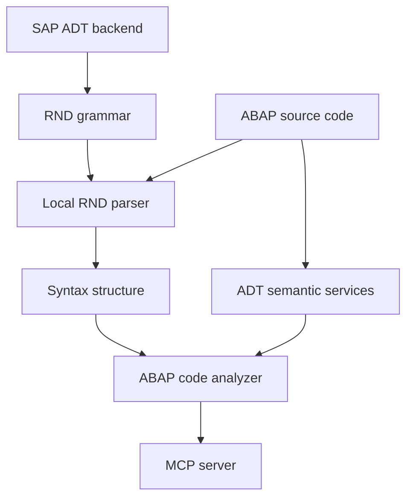

# Research: ABAP parsing capabilities in ADT and the ABAP system

Input for strengthening the server's analytical capabilities, beside `AdtCodeAnalyzer`
(`docs/architecture/SOURCE_PARTS.md` §4). This is the owner's analysis, translated. Each claim
carries how it is known:
- **Discovery**: checked against the recorded discovery documents in mcp-abap-adt-clients
  (`packages/adt-clients/corpus/adt/discovery/system-description-{basis-740,s4-2025,abap-cloud}--03-discovery.body.xml`).
- **Measured**: called on the on-premise test system on 2026-11-29.
- **Handler code**: SAP's handler source, read on the on-premise test system on 2026-11-29.
- **Claimed**: from the analysis, not verified by discovery, measurement or handler code.

## Conclusion

The native SAP grammar can be read. Access to a server-side AST is not confirmed.

The first thing to research is the grammar file's format and the RND runtime. If the runtime can
be implemented in TypeScript, the server gets a local syntax analyser whose grammar matches the
ABAP version of the target system, rather than the fixed version of a third-party parser.

## 1. The ABAP RND parser

`GET /sap/bc/adt/abapsource/parsers/rnd/grammar`, registered in discovery as:

```xml
<app:collection href="/sap/bc/adt/abapsource/parsers/rnd/grammar">
  <atom:title>Parser</atom:title>
  <atom:category term="parser" scheme="http://www.sap.com/adt/categories/abapsource"/>
</app:collection>
```

- **Discovery.** It is listed on SAP_BASIS 7.40, S/4HANA 2025 and ABAP Cloud.
- **Measured.** The endpoint answers `200` with `text/plain; charset=utf-8`, 1,389,041 bytes, and
  an `ETag` of `816`. The text begins with a header: `Release 700`, `Patchlevel 19`,
  `MaxSuspiciousMachtes 3` (SAP's spelling), `Token 112 1298 2899`. A numbered token table
  follows: `0 "#ANYKW#"`, `1 "#ANYLIT#"`, `2 "#EOF#"`, `3 "#NL#"`, `4 "#COMMENT1#"`,
  `5 "#COMMENT2#"`, `6 "."`, `7 ","`, `8 ":"`, `9 "#PRAGMA#"`, then literal, string-template and
  dynamic-identifier classes.
**Handler code** (read on the on-premise test system, 2026-11-29):
- **Registration.** `CL_SEDI_ADT_RES_APP_ABAPSOURCE` registers `/abapsource/parsers/rnd/grammar`
  as a discoverable resource (description `Parser`, term `parser`) and the template
  `/abapsource/parsers/rnd/grammar/{version}`, both to the handler `CL_SEDI_ADT_RES_RND`
  (through `if_sedi_adt_res_rnd_co=>co_class_name`).
- **`CL_SEDI_ADT_RES_RND->get`**, a subclass of `cl_adt_rest_resource` that implements only `GET`:
  - It refuses a user without IDE authorisation
    (`cl_adt_permission_control=>is_authorized_to_use_ide`, else `cx_adt_res_no_authorization`).
  - It reads the optional URI attribute `version`, one character (`char1`).
  - It sets the `ETag` to `sy-saprl` followed by the version (`get_etag`). Measured `816` is the
    release with no version.
  - It answers `304 Not Modified` when `If-None-Match` equals that `ETag`, so a client can cache
    the grammar per release and version.
  - With the query parameter `head=true` it answers no grammar, only the `ETag`.
  - A URI containing `/release` answers the release (the `ETag`) as the body. No registration
    for such a path was found in `CL_SEDI_ADT_RES_APP_ABAPSOURCE`.
  - Otherwise it answers the grammar as plain text through `read_rnd_pad_file`.
- **Where the grammar comes from.** `read_rnd_pad_file` calls `CL_ABAP_PARSER=>GET_ABAP_PAD_FILE`
  with no version. That method is implemented by the kernel module `ab_km_get_abap_pad_file`, so
  the grammar is the kernel's own. The result is converted from the code page into the text.
  With a version it calls `CL_ABAP_PARSER=>RESTRICT_PAD( version )`, which restricts the grammar
  to the keywords that table `SYCH_VERSION` allows for that ABAP language version (local class
  `lcl_restrict`). An empty result is `cx_adt_res_not_found` for resource type `grammer` (SAP's
  spelling), that is a `404`.
- **Confirmed by the code:** the version variant exists as a path segment, `.../grammar/{version}`,
  with the ABAP language version as its value. The internal name "pad file" is SAP's
  (`read_rnd_pad_file`, `GET_ABAP_PAD_FILE`).
- **Still claimed:** that RND stands for "Recursive Non-Descent", and that Eclipse ADT uses the
  grammar for local analysis, highlighting and completion. The server code shows only that the
  grammar is served.

**No server-side AST in this class.** `CL_ABAP_PARSER` also has `GET_TOKENS( source ) → tokens`
(kernel module `ab_km_get_tokens`), plus code completion, element info and quick info. It has no
method that answers a parse tree. Which ADT resource, if any, exposes `GET_TOKENS` was not
searched.

## 2. Related endpoints per system

All paths are relative to `/sap/bc/adt`. ✅ means the endpoint is present in the recorded
discovery document, not merely mentioned in documentation (Discovery).

| Endpoint | 7.40 | S/4 2025 | ABAP Cloud |
|---|---|---|---|
| `abapsource/parsers/rnd/grammar` | ✅ | ✅ | ✅ |
| `abapsource/syntax/configurations` | — | ✅ | — |
| `checkruns` | ✅ | ✅ | ✅ |
| `checkruns/reporters` | ✅ | ✅ | ✅ |
| `abapsource/codecompletion/proposal` | ✅ | ✅ | ✅ |
| `abapsource/codecompletion/elementinfo` | ✅ | ✅ | ✅ |
| `abapsource/occurencemarkers` | ✅ | ✅ | ✅ |
| `abapsource/typehierarchy` | ✅ | ✅ | ✅ |
| `navigation/target` | ✅ | ✅ | ✅ |
| `refactorings` | ✅ | ✅ | ✅ |
| `abapsource/prettyprinter` | ✅ | ✅ | ✅ |

## 3. What can be obtained for ABAP analysis

| Capability | ADT endpoint | Result |
|---|---|---|
| ABAP grammar | `abapsource/parsers/rnd/grammar` | The grammar definition |
| Syntax check | `checkruns` | Errors, warnings, positions in the code |
| Object structure | `objectstructure` | Methods, declarations, blocks, positions |
| Semantic information | `abapsource/codecompletion/elementinfo` | Information about an element |
| Declaration lookup | `navigation/target` | A link to the definition |
| Identifier usage | `abapsource/occurencemarkers` | Positions of occurrences |
| Type hierarchy | `abapsource/typehierarchy` | Type hierarchy information |
| A full AST | not found | Needs research |

adt-clients already implements `checkruns` and `objectstructure`. adt-clients' check members send
the source in the request body (`chkrun:artifact` / `chkrun:content`); that SAP checks the sent
text instead of the saved one is claimed, since the `checkruns` handler was not read. The class
outline's positions are measured in `SOURCE_PARTS.md`.

## 4. Parsers for CDS, RAP and DDIC sources

Discovery also lists language-specific parser endpoints, so the mechanism is not limited to
classic ABAP:

| Endpoint | Language | 7.40 | S/4 2025 | ABAP Cloud |
|---|---|---|---|---|
| `bo/behaviordefinitions/parser/info` | RAP behavior definition | — | ✅ | ✅ |
| `ddic/ddl/parser` | CDS DDL | ✅ | ✅ | ✅ |
| `acm/dcl/parser` | CDS DCL | — | ✅ | ✅ |
| `ddic/ddla/parser/info` | CDS annotation definition | — | ✅ | ✅ |
| `ddic/ddlx/parser/info` | Metadata extension | — | ✅ | ✅ |
| `ddic/structures/parser/info` | DDIC structure | — | ✅ | ✅ |
| `ddic/tables/parser/info` | DDIC table | — | ✅ | ✅ |
| `ddic/srvd/parser/info` | Service definition | — | ✅ | ✅ |
| `ddic/dteb/parser/info` | Entity buffer | — | ✅ | ✅ |
| `ddic/drul/parser/info` | DRUL | — | ✅ | ✅ |

The per-system columns are Discovery; the analysis listed the endpoints without them.

## 5. How it could be used

The most interesting option is a local ABAP parser that uses the grammar read from the target
system itself:



Possible capabilities:
- splitting ABAP code into tokens and statements;
- identifying syntax blocks;
- building an AST, if the RND runtime allows it;
- structural search over code;
- semantic analysis;
- targeted modification of code that respects its structure;
- indexing ABAP code for retrieval by logical blocks.

**Claimed.** SAP's ABAP Cleaner already uses the Java classes `ABAPRndParser` and
`com.sap.rnd.rndrt`, an example of the mechanism used outside the ADT editor. Whether an
independent RND runtime exists for TypeScript, and whether it may be distributed, is an open
question.

## 6. Relation to the current design

`SOURCE_PARTS.md` decides that the pieces of a source are located by SAP's outline and
navigation, with the end of a block found by the analyzer's own scanner (plain string code, no
regular expression, no abaplint). A local RND parser would be a different means to the same end.
This research does not change that decision; it is input for deciding whether a later stage
replaces or complements the scanner.

## Open questions

1. The grammar format: its header, token table and rule encoding, read from the measured text.
   It comes from the kernel (`ab_km_get_abap_pad_file`), so no ABAP code documents it.
2. The RND runtime: whether it is documented, and whether an implementation may be written or
   distributed with this project.
3. The version segment's values: those in table `SYCH_VERSION` on each system, not yet read.
4. Whether any ADT resource answers tokens (`CL_ABAP_PARSER=>GET_TOKENS`) or a parse tree for a
   given source.
5. The grammar and its handler on SAP_BASIS 7.40 and on ABAP Cloud: read only on premise so far.
6. The `checkruns` handler: whether it checks the sent source instead of the saved one.
